<div align="center">


# Heliora

**Engineering calculations and block-diagram simulation for solar photovoltaic plants.**

Model the plant and its inverters, analyse its operating data and plan its maintenance
in a single desktop application that works offline.

[](https://github.com/YAGOHEHE/heliora/actions/workflows/ci.yml)
[](https://github.com/YAGOHEHE/heliora/actions/workflows/instaladores.yml)


[](LICENSE)

[Español](README.md) · **English** · [简体中文](README.zh-CN.md)

[Install](#install) · [Features](#features) · [Architecture](#architecture) ·
[Development](#development) · [Documentation](#documentation)

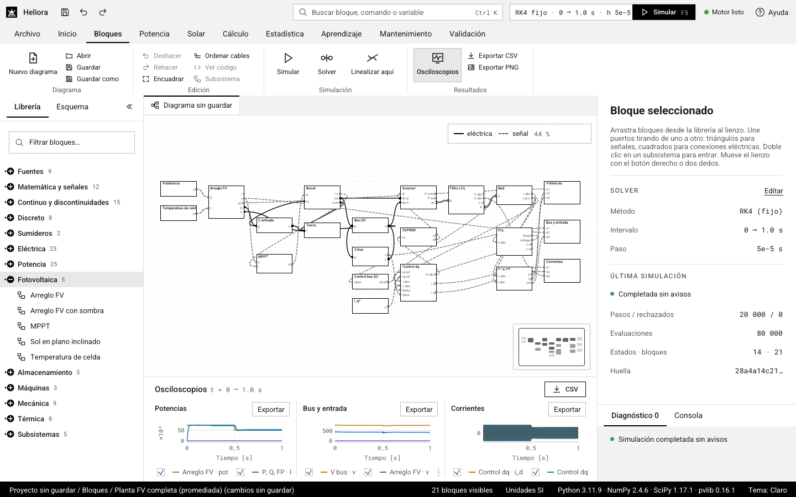

</div>

> [!NOTE]
> The application interface and the technical documentation are in Spanish.

## What it is

Heliora brings the engineering work of a photovoltaic plant together in one window:

| Area | What it does |
|---|---|
| **Simulation** | Block diagrams with 127 blocks (electrical, power electronics, photovoltaic, thermal, machines, storage, control), four solvers and linearisation. |
| **Computation** | Python console and scripts with a workspace, data import and 2D and 3D plots. |
| **Analysis** | Power electronics, PV modules, statistics and machine learning through forms with exportable reports. |
| **Operations** | SCADA data, plant KPIs, fault detection, reliability and maintenance planning. |
| **Validation** | Test bench in phases against analytical solutions and datasheets, with the error of every measurement. |

## Install

The installers include Python and all its libraries: nothing else needs to be installed.

| System | File | Notes |
|---|---|---|
| Windows 10/11 (64-bit) | `Heliora-Setup-<version>.exe` | Installs in the user folder, without administrator rights, with Start menu shortcuts and, optionally, a desktop shortcut. |
| macOS 11 or later (Apple Silicon) | `Heliora-<version>-macos-arm64.dmg` | Drag Heliora to Applications. |

Download them from [Releases](https://github.com/YAGOHEHE/heliora/releases) (versions tagged `v*`) or
from the artifacts of the latest
[Instaladores](https://github.com/YAGOHEHE/heliora/actions/workflows/instaladores.yml) run on `main`.

> [!NOTE]
> The installers are not digitally signed, so the system warns the first time.
> **Windows:** under "Windows protected your PC", click "More info" and "Run anyway".
> **macOS:** right-click Heliora → "Open", or System Settings → Privacy & Security → "Open Anyway".

## Features

### Home

Access to the modules, the open project, plant KPIs, upcoming work orders and the validation status.
If the engine or the test bench changed since the last validation, the result is marked as historical
and the app offers to validate again. The top bar holds the command palette (`Ctrl K`) and
"Simulate" (`F5`) from any module.

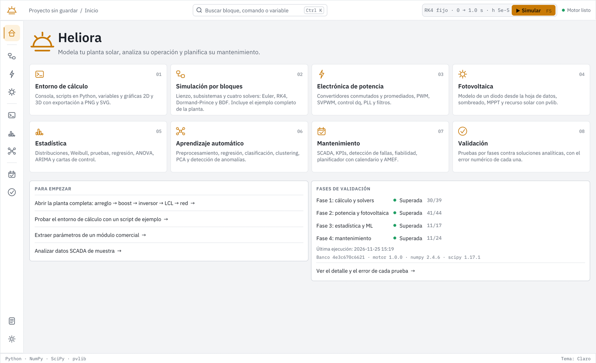

### Block-diagram simulation

Canvas with a block library, subsystems, four solvers (Euler, RK4, Dormand-Prince and BDF), algebraic
loop detection and linearisation at the operating point with Bode, step response and poles. Includes a
minimap, right-angle wiring, recent blocks, help for every parameter and the result of the last
simulation with its sha256 fingerprint. "Linearise here" also stores the model in the variable `lin`,
used by the Control tools with "Plant: linearised model".

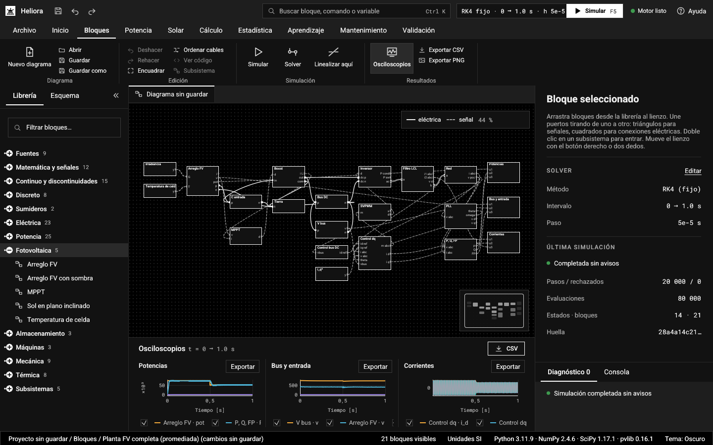

### Computing environment

Python console and scripts, a workspace to view and export variables, import of CSV (including
Spanish-locale Excel files: `;` separator, decimal comma and Windows-1252), TSV and Parquet, and plots
exportable to PNG and SVG.

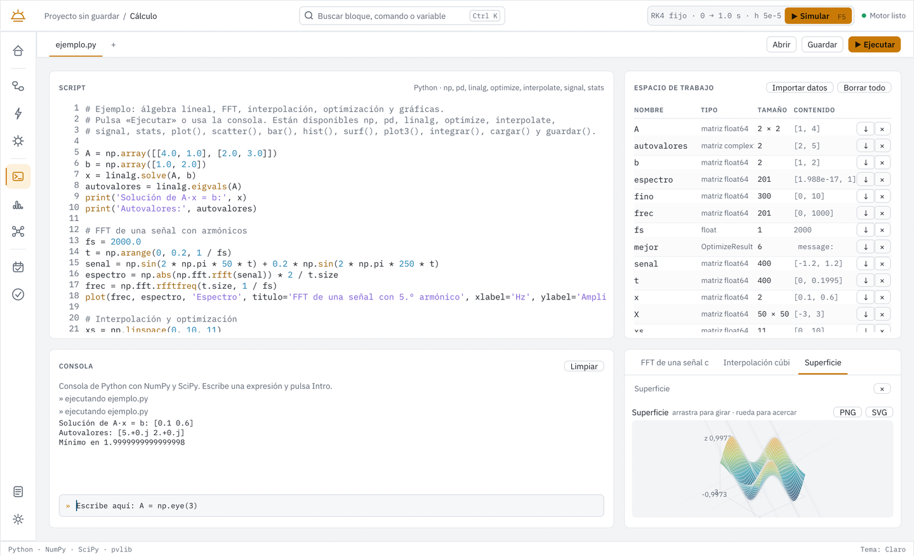

### Power electronics

Inverter losses and efficiency, LCL filter (resonance, frequency response and design values) and
control: Bode and margins, step response, root locus and PI tuning.

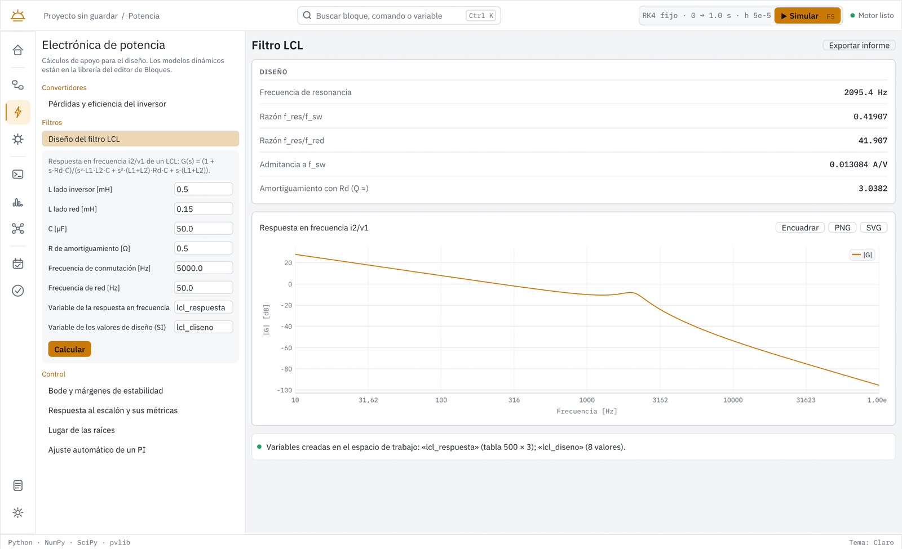

### Photovoltaics

Single-diode model from the datasheet, I-V and P-V curves by irradiance and temperature, partial
shading with bypass diodes and solar resource with pvlib. It also searches the pvlib CEC database
(about 21,500 commercial modules).

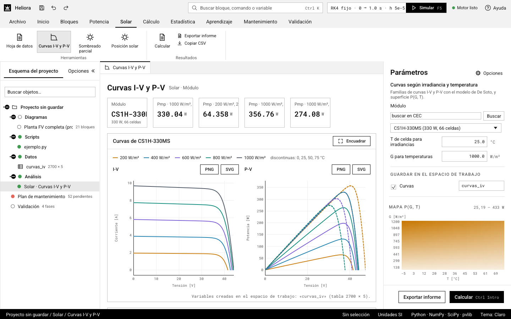

### Statistics and machine learning

Descriptive statistics, distributions, Weibull, hypothesis tests, regression, ANOVA, time series and
statistical process control. Regression and classification with random, time-based or hold-out
validation, overfitting warnings, clustering, PCA, anomaly detection and "Apply model" with a trained
or saved model.

<table>
<tr>
<td>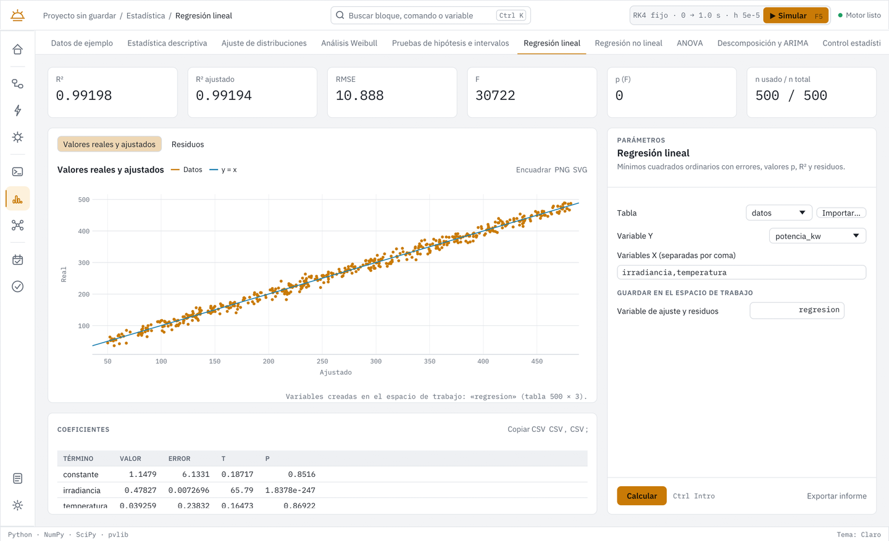</td>
<td>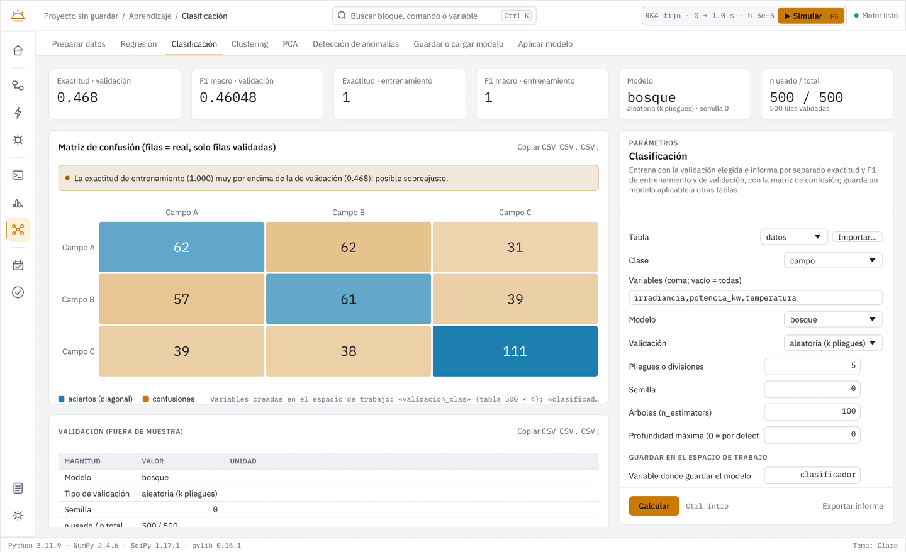</td>
</tr>
</table>

### Maintenance

Import of real SCADA data (regional CSV formats, day/month dates, column names with units, duplicates)
and plant KPIs: each inverter is integrated with its own logging interval, and the report states the
data coverage and which KPIs cannot be computed. Fault detection, reliability, and a planner with a
board, calendar, work orders, equipment catalogue, plans, FMEA and an O&M report.

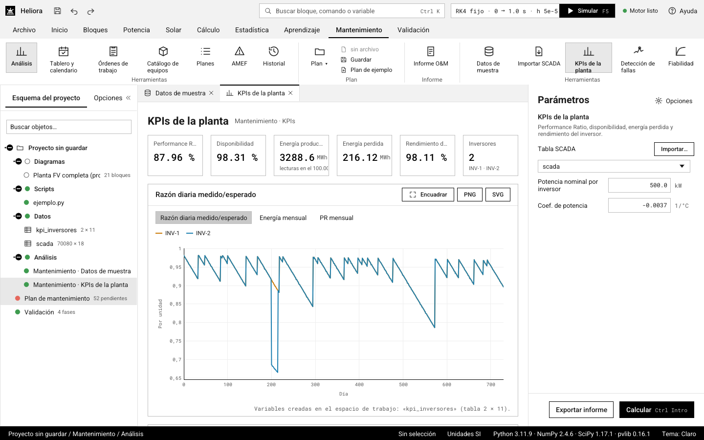

<table>
<tr>
<td>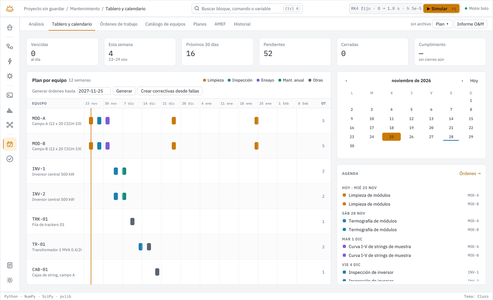</td>
<td>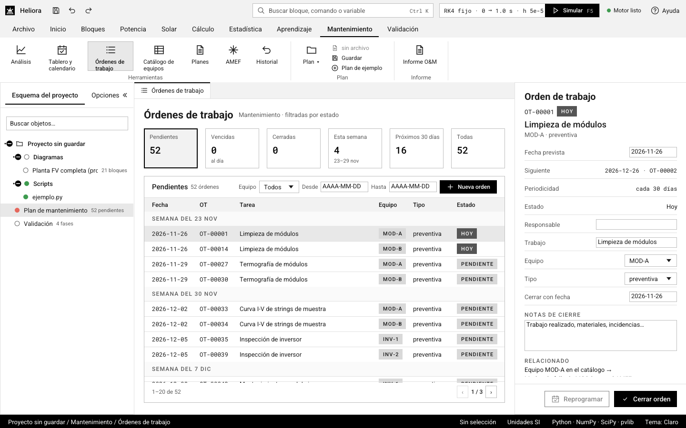</td>
</tr>
</table>

### Validation

Tests in phases against analytical solutions and datasheets, with the numerical error of every
measurement against its tolerance. A phase does not run until the previous one passes all its tests.

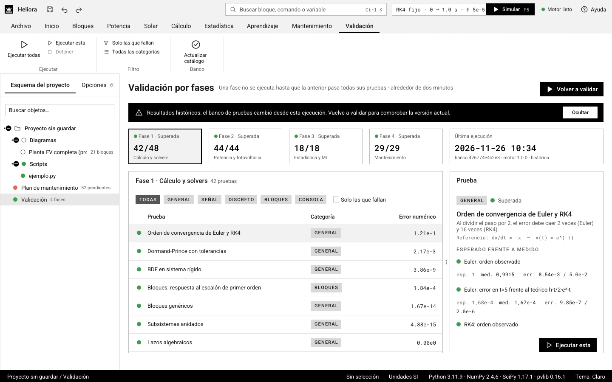

## Architecture

The window and the engine are two processes that talk over standard input and output with JSON
messages, one per line. The window does not compute: it draws and sends commands; the engine
simulates, analyses and validates.

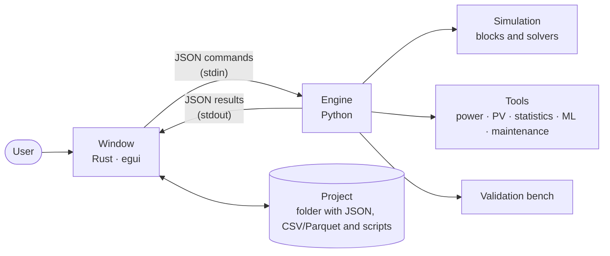

| Component | Technology |
|---|---|
| Window | Rust, [egui/eframe](https://github.com/emilk/egui) 0.33 |
| Computation engine | Python 3.12 with NumPy, SciPy, pandas, scikit-learn, statsmodels and pvlib |
| Project format | Folder with canonical JSON, CSV or Parquet and `.py` scripts, designed for Git |
| Installers | python-build-standalone, Inno Setup (Windows), `.app`/`.dmg` (macOS) |
| Continuous integration | GitHub Actions: checks on Windows, macOS and Linux; installers |

## Development

Requirements: stable Rust and Python 3.11 or 3.12 (on Windows, Rust with the MSVC toolchain).

    git clone https://github.com/YAGOHEHE/heliora.git
    cd heliora
    python -m venv .venv
    .venv/bin/pip install -r engine/requirements.txt     # Windows: .venv\Scripts\pip
    cargo run

Tests:

    cargo clippy -- -D warnings && cargo test
    cd engine && ../.venv/bin/python validar_todo.py      # Windows: ..\.venv\Scripts\python

```
heliora/
├── src/                 window (Rust/egui)
├── engine/
│   ├── heliora/         engine: server, simulation (sim/), libraries (lib/), tools, validation
│   ├── ejemplos/        example diagrams in JSON
│   └── validar_todo.py  full test bench
├── packaging/           Windows and macOS installers
├── docs/                technical documentation and screenshots
└── MECHANICS.md         source of every model value
```

## Documentation

All documents are in Spanish.

| Document | Contents |
|---|---|
| [docs/desarrollo.md](docs/desarrollo.md) | Local setup, file map, tests, result provenance, projects and Git, CI |
| [MECHANICS.md](MECHANICS.md) | Where every model value comes from and which ones are estimated |
| [docs/diseno_motor_dae.md](docs/diseno_motor_dae.md) | Proposed design of the DAE engine (not built) |

## License

Distributed under the [MIT License](LICENSE).
