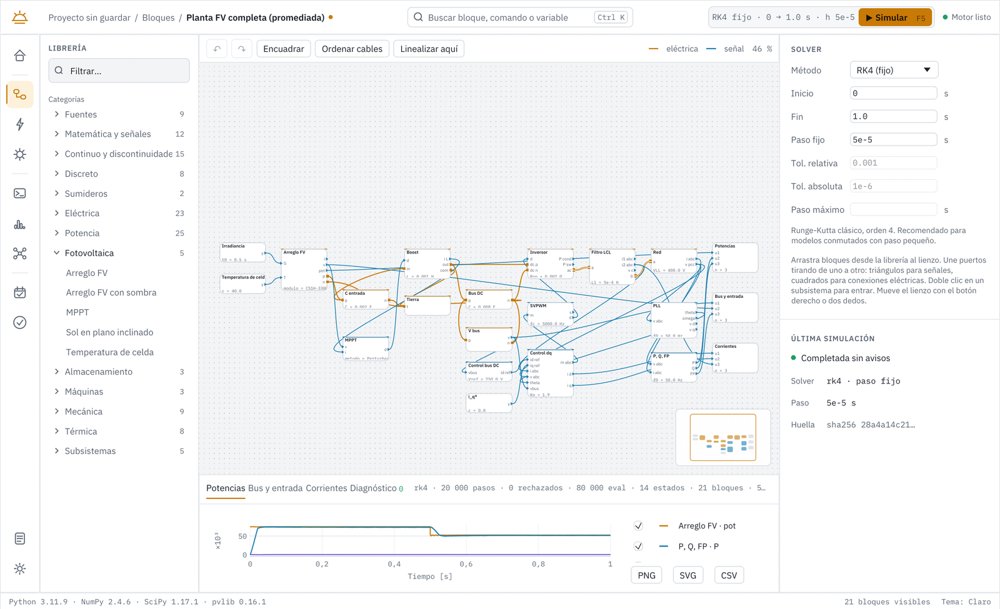
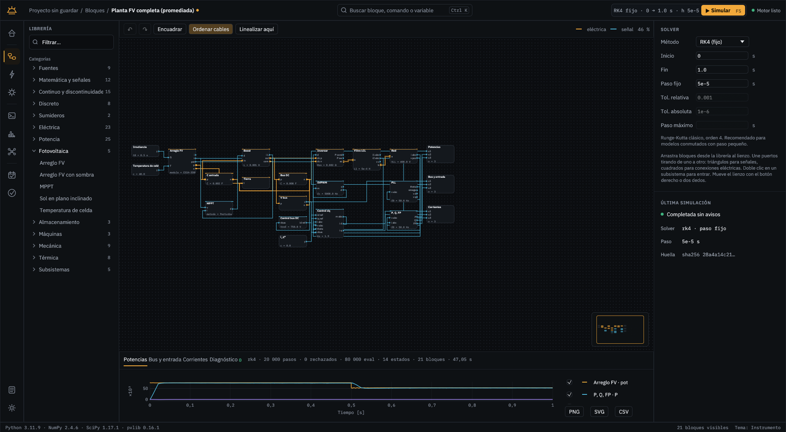
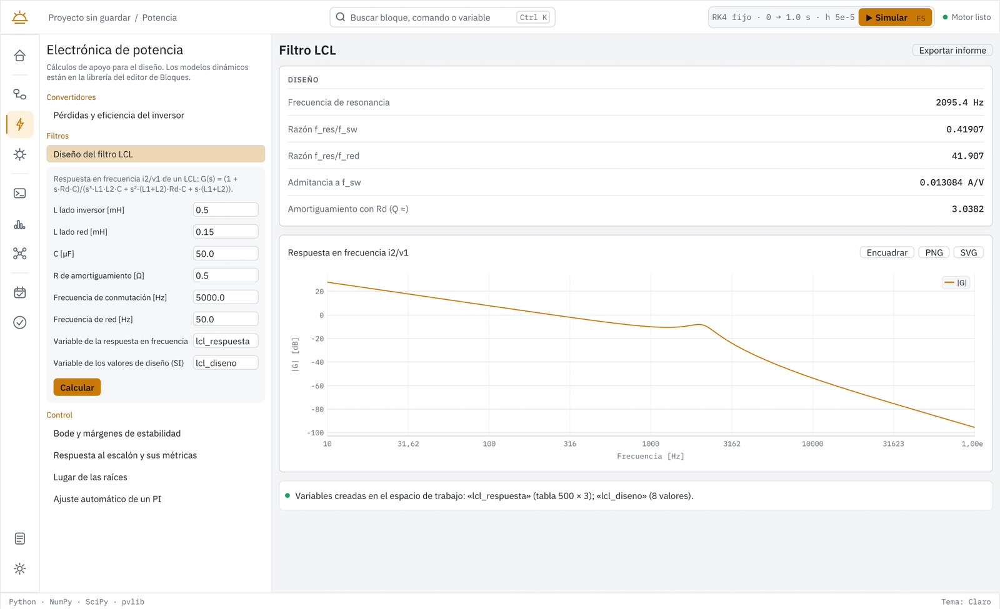
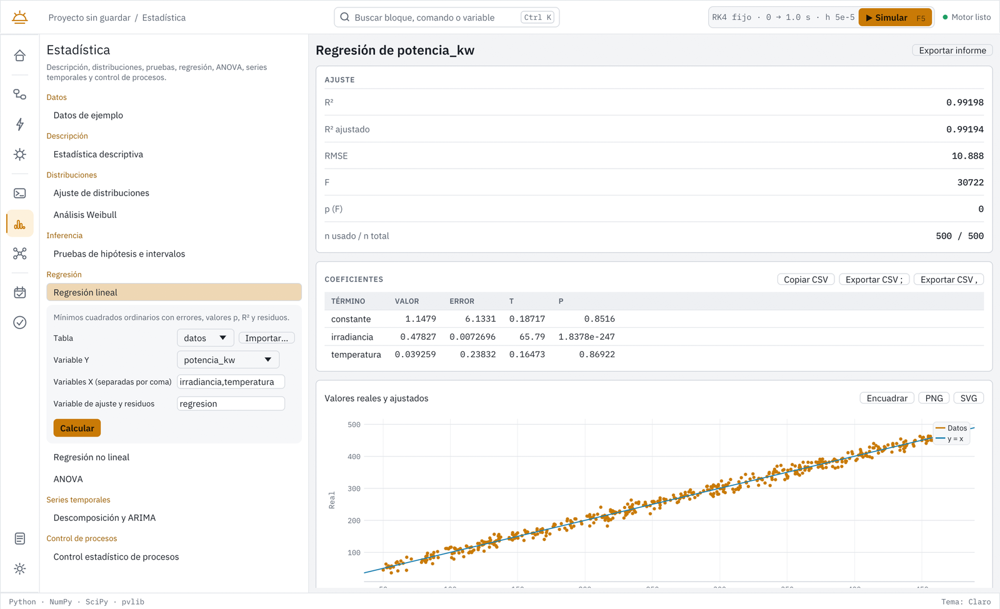
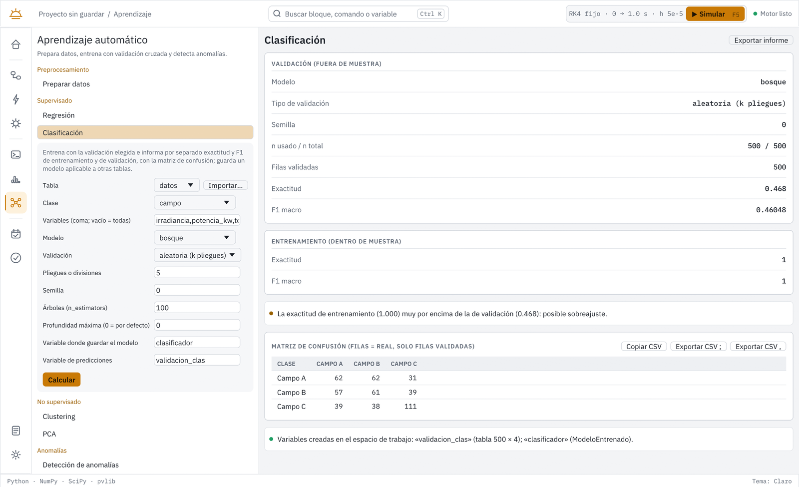
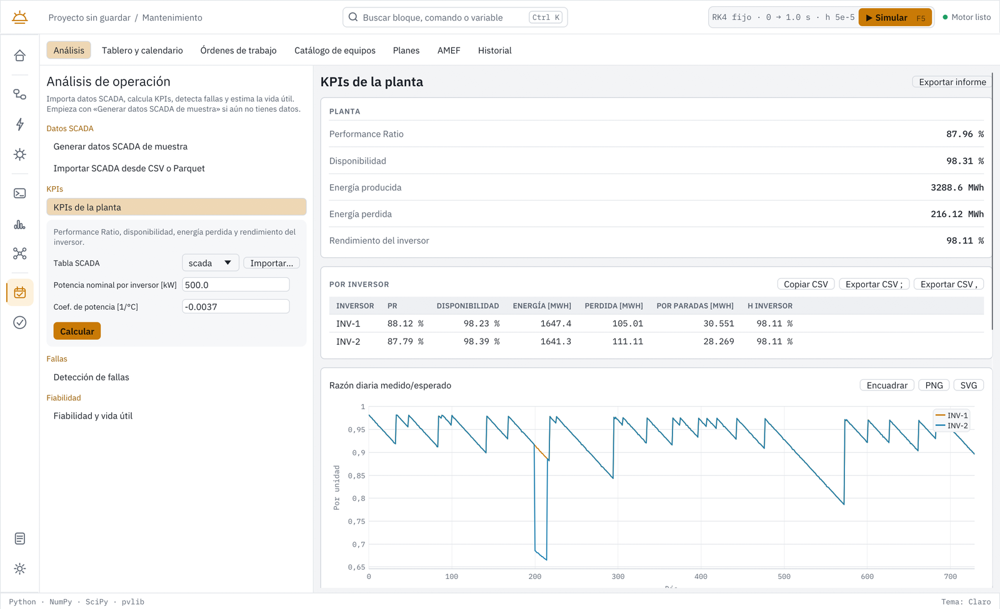
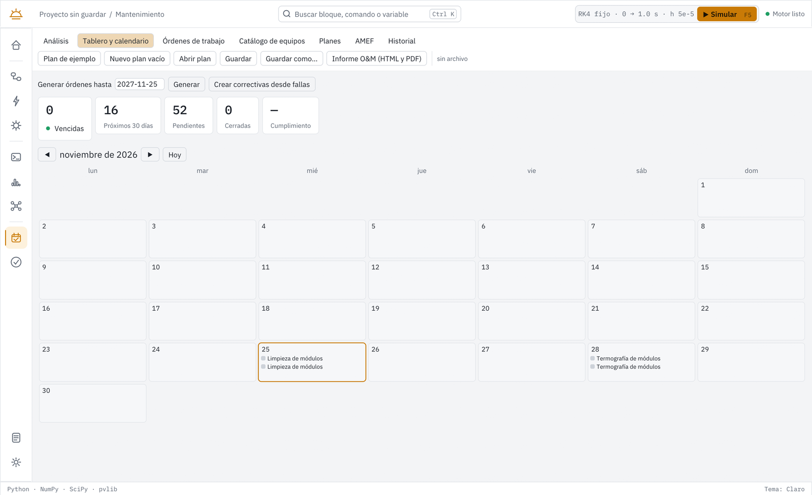
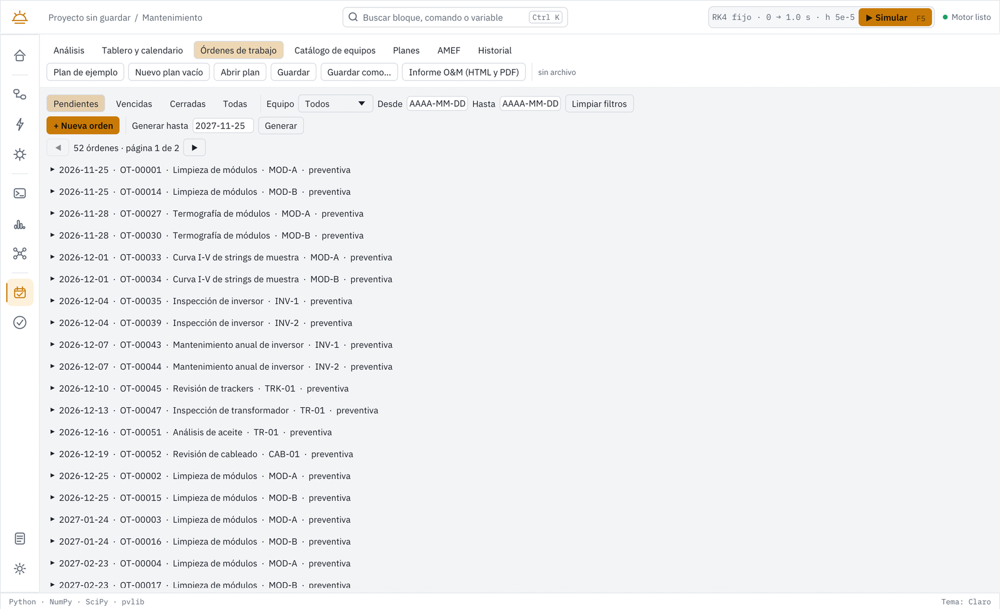

# Heliora

Aplicación de escritorio de cálculo técnico y simulación por bloques, para modelar una planta solar
fotovoltaica con sus inversores, analizar sus datos de operación y planificar su mantenimiento.

- **Ventana:** Rust con egui (`src/`), modo claro y modo oscuro «Instrumento».
- **Motor de cálculo:** Python con NumPy, SciPy, pandas, scikit-learn, statsmodels y pvlib (`engine/heliora/`).
  Se comunica con la ventana por entrada y salida estándar, con JSON por líneas.

## Instalar

Los instaladores incluyen Python y todas sus librerías: no hace falta instalar nada más ni tener
conexión a internet. Se generan en GitHub Actions (flujo «Instaladores»): en cada cambio de `main`
quedan como artefactos de la ejecución, y con cada etiqueta `v*` se publican en Releases.

| Sistema | Archivo | Notas |
|---|---|---|
| Windows 10/11 (64 bits) | `Heliora-Setup-<versión>.exe` | Instala en la carpeta del usuario, sin permisos de administrador, con accesos en el menú Inicio y, si se elige, en el Escritorio. |
| macOS 11 o posterior (Apple Silicon) | `Heliora-<versión>-macos-arm64.dmg` | Se arrastra Heliora a Aplicaciones. |

Los instaladores no llevan firma digital de un desarrollador verificado, así que el sistema avisa la
primera vez:

- **Windows:** SmartScreen muestra «Windows protegió su PC». Se pulsa «Más información» y «Ejecutar de
  todas formas».
- **macOS:** Gatekeeper indica que no puede verificar al desarrollador. Se abre con clic derecho sobre
  Heliora → «Abrir», o en Ajustes del Sistema → Privacidad y seguridad → «Abrir igualmente».

Para quitar esos avisos hace falta un certificado de firma (Apple Developer Program para macOS;
certificado de firma de código o Azure Trusted Signing para Windows) guardado como secreto del
repositorio; el flujo de la CI admite añadir ese paso.

## Funcionalidades

### Inicio

Acceso a los módulos, primeros pasos y estado de las fases de validación. La barra superior lleva la
ruta del proyecto, el buscador de comandos (`Ctrl K`: bloques, comandos, módulos, ejemplos y variables)
y la píldora del solver con «Simular» (`F5`), disponible desde cualquier módulo.

### Simulación por bloques

Lienzo con librería de más de 120 bloques (fuentes, matemática, control, eléctrica, potencia,
fotovoltaica, almacenamiento, máquinas, térmica), subsistemas, cuatro solvers (Euler, RK4,
Dormand-Prince y BDF), detección de lazos algebraicos y linealización con Bode, escalón y polos.
Incluye minimapa, cables en ángulo recto («Ordenar cables»), bloques recientes, ayuda de cada
parámetro y el resultado de la última simulación con su huella sha256. Los bloques «Desde CSV» y
«Desde espacio de trabajo» eligen columnas y variables en desplegables.

### Entorno de cálculo

Consola y scripts de Python, espacio de trabajo con vista y exportación de variables, importación de
CSV (también los de Excel en español: separador «;», coma decimal y Windows-1252), TSV y Parquet, y
gráficas 2D y 3D exportables a PNG y SVG.

### Electrónica de potencia

Pérdidas y eficiencia del inversor, filtro LCL (resonancia, respuesta en frecuencia y valores de diseño
en SI) y control: Bode y márgenes, escalón, lugar de las raíces y ajuste de un PI. Los resultados quedan
en el espacio de trabajo y los informes se exportan a HTML; las tablas, a CSV.

### Fotovoltaica

Modelo de un diodo desde la hoja de datos, curvas I-V y P-V por irradiancia y temperatura, sombreado
parcial con diodos de bypass y recurso solar con pvlib. Además de los módulos propios, busca en la base
CEC de pvlib (unos 21 500 módulos comerciales).

### Estadística

Descriptiva, ajuste de distribuciones, Weibull, pruebas de hipótesis, regresión lineal y no lineal,
ANOVA, descomposición y ARIMA y control estadístico de procesos. Cada tabla se elige del espacio de
trabajo o se importa desde el ordenador con «Importar…».

### Aprendizaje automático

Preparación de datos, regresión y clasificación con validación aleatoria, temporal o con conjunto de
prueba (métricas de entrenamiento y de validación por separado, aviso de sobreajuste e
hiperparámetros editables), clustering, PCA, detección de anomalías y «Aplicar modelo» para predecir
con un modelo entrenado o guardado.

### Mantenimiento

Importación de SCADA real (CSV regionales, fechas día/mes, fecha y hora en columnas separadas,
nombres de columna con unidades, duplicados), KPIs, detección de fallas y fiabilidad. Planificador con
tablero, calendario, órdenes de trabajo (crear, editar, reprogramar, cerrar, reabrir y borrar),
catálogo de equipos, planes, AMEF e historial, con exportación a CSV e informe O&M.

### Validación

Pruebas por fases contra soluciones analíticas y hojas de datos, con el error numérico de cada una.

## Desarrollo

    cargo run

La aplicación busca Python junto al motor: primero el Python incluido en los instaladores
(`python/`), después `.venv/`. Si no hay ninguno, ofrece un botón «Instalar el motor».
También se puede preparar a mano:

    python3 -m venv .venv
    .venv/bin/pip install -r engine/requirements.txt

En Windows (PowerShell), con Python 3.11 o 3.12 de python.org y Rust con la cadena MSVC
(el instalador `rustup-init` ofrece instalar Visual Studio Build Tools si faltan):

    py -3 -m venv .venv
    .venv\Scripts\python -m pip install -r engine\requirements.txt
    cargo run

En Windows la aplicación busca `.venv\Scripts\python.exe` y, si no está, `python`. La instalación
desde el botón usa el lanzador `py`. Si Python está en otro sitio, la variable `HELIORA_PYTHON` indica
la ruta del intérprete; `HELIORA_ENGINE`, la de la carpeta `engine`.

Para montar localmente el motor autocontenido de los instaladores:

    bash packaging/preparar_motor.sh dist/Heliora x86_64-pc-windows-msvc   # o aarch64-apple-darwin

## Dónde está cada cosa

| Tema | Archivo |
|---|---|
| Solvers | `engine/heliora/sim/solvers.py` |
| Bloques genéricos | `engine/heliora/sim/bloques_genericos.py` |
| Red eléctrica (análisis nodal) | `engine/heliora/sim/circuito.py` |
| Elementos eléctricos | `engine/heliora/lib/electrica.py` |
| Convertidores, modulación, control y medida | `engine/heliora/lib/potencia.py` |
| Fotovoltaica | `engine/heliora/lib/fotovoltaica.py` |
| Señal, control (PID) y tiempo discreto | `engine/heliora/lib/senal.py` |
| Dominio térmico y uniones de semiconductores | `engine/heliora/lib/termica.py` |
| Batería, supercondensador y cargador DC-DC | `engine/heliora/lib/almacenamiento.py` |
| Dominio mecánico rotacional | `engine/heliora/lib/mecanica.py` |
| Máquinas (continua, PMSM, inducción) | `engine/heliora/lib/maquinas.py` |
| Diseño propuesto del motor DAE (sin construir) | `docs/diseno_motor_dae.md` |
| Estadística | `engine/heliora/lib/estadistica.py` |
| Aprendizaje automático | `engine/heliora/lib/aprendizaje.py` |
| Mantenimiento | `engine/heliora/lib/mantenimiento.py` |
| Formularios de análisis | `engine/heliora/herramientas.py` |
| Validación de entradas de los formularios | `engine/heliora/entradas.py` |
| Lectura de CSV, TSV y Parquet | `engine/heliora/lectura.py` |
| Guardado del espacio de trabajo | `engine/heliora/almacen.py` |
| Instaladores (Windows y macOS) | `packaging/`, `.github/workflows/instaladores.yml` |
| Pruebas por fases | `engine/heliora/validacion/` |
| Diagramas de ejemplo en JSON | `engine/ejemplos/` |

Cada bloque es una clase corta con sus ecuaciones en su documentación. Desde la aplicación se abre con
«Ver y editar código»; al guardar, el motor vuelve a cargar los bloques.

## Proyectos

Un proyecto es una carpeta: `proyecto.json`, `diagramas/*.json`, `datos/*.csv` o `*.parquet`, `scripts/*.py`
y `mantenimiento.json`.

### Trabajar con Git

Cada carpeta de proyecto puede ser un repositorio (carpeta = proyecto). Heliora guarda los diagramas en
**JSON canónico**: claves en orden alfabético, bloques ordenados por identificador, conexiones por sus
extremos y sangría fija de 2 espacios. Guardar dos veces el mismo diagrama da el mismo archivo, byte a byte,
y cambiar un parámetro cambia una sola línea, así que el diff de Git muestra justo lo que cambió.

    cd mi_proyecto
    git init
    git add proyecto.json diagramas scripts mantenimiento.json .gitattributes
    git commit -m "Planta inicial"
    # ... cambia Kp del PI en la aplicación y guarda ...
    git diff diagramas/principal.json      # una línea: "Kp": 2.0 → "Kp": 3.0

Al guardar un proyecto se crea su `.gitattributes` (JSON y scripts como texto con fin de línea LF;
Parquet, PNG y PDF como binarios). Los datos grandes (`datos/*.parquet`) conviene dejarlos fuera del
repositorio o usar Git LFS.

## Pruebas

En la aplicación, módulo Validación. Desde la línea de órdenes:

    cd engine
    ../.venv/bin/python -c "from heliora.validacion import banco; banco.imprimir(banco.ejecutar(4))"

O todas las fases con su resumen (en Windows, `..\.venv\Scripts\python validar_todo.py`):

    ../.venv/bin/python validar_todo.py

Cada simulación, linealización y validación devuelve un bloque `procedencia`:

- `sha256`: huella de la entrada (el diagrama tal como se envió, o el código del banco de pruebas).
- En simulación y linealización, además, `sha256_resuelto` (los parámetros de cada bloque ya evaluados
  con el espacio de trabajo: el mismo diagrama con otra variable da otra huella), `sha256_codigo` (el
  código de los bloques usados y del núcleo de simulación, incluidas las ediciones locales) y la lista
  `archivos_codigo`.
- Las versiones del motor, de Python y de NumPy, SciPy, pandas, scikit-learn, statsmodels, pvlib, joblib
  y pyarrow.

Son huellas, no copias: identifican qué se ejecutó, pero el código y los datos no se guardan con el
resultado. Para reproducirlo hace falta conservar esos archivos (por ejemplo, en Git).

## Linealización

En Bloques, «Linealizar aquí» calcula el modelo lineal (A, B, C, D) del diagrama en su punto de
operación: simula hasta el final, refina con Newton (f = 0) y deriva por diferencias centrales. La
entrada es la primera fuente del diagrama; la salida, el bloque seleccionado o la señal del primer
osciloscopio. Abre su Bode, su respuesta al escalón y sus polos, y deja la variable `lin` en la consola,
que usan las herramientas de Control con «Planta: modelo linealizado».

## Datos de los valores

`MECHANICS.md` explica de dónde sale cada valor y cuáles son estimados.
