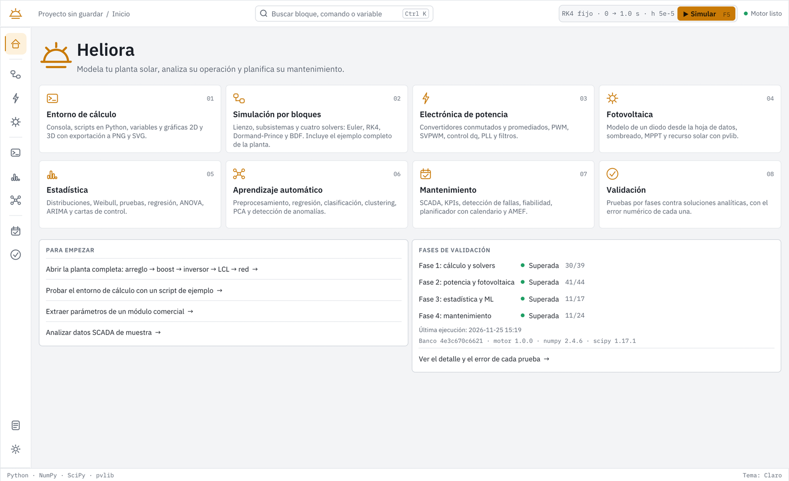
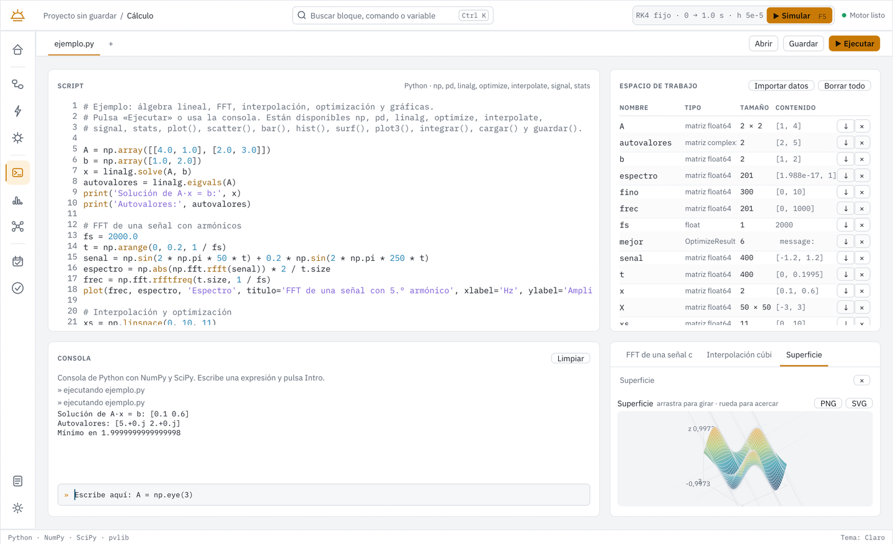
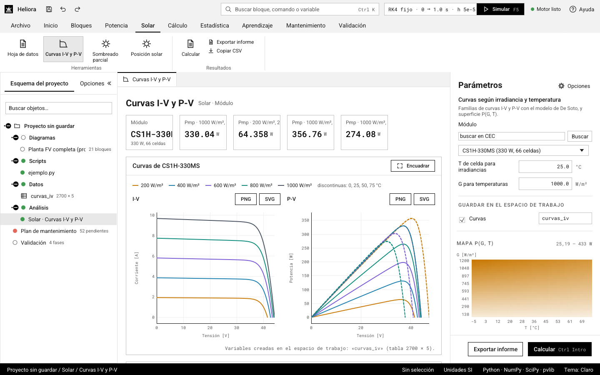
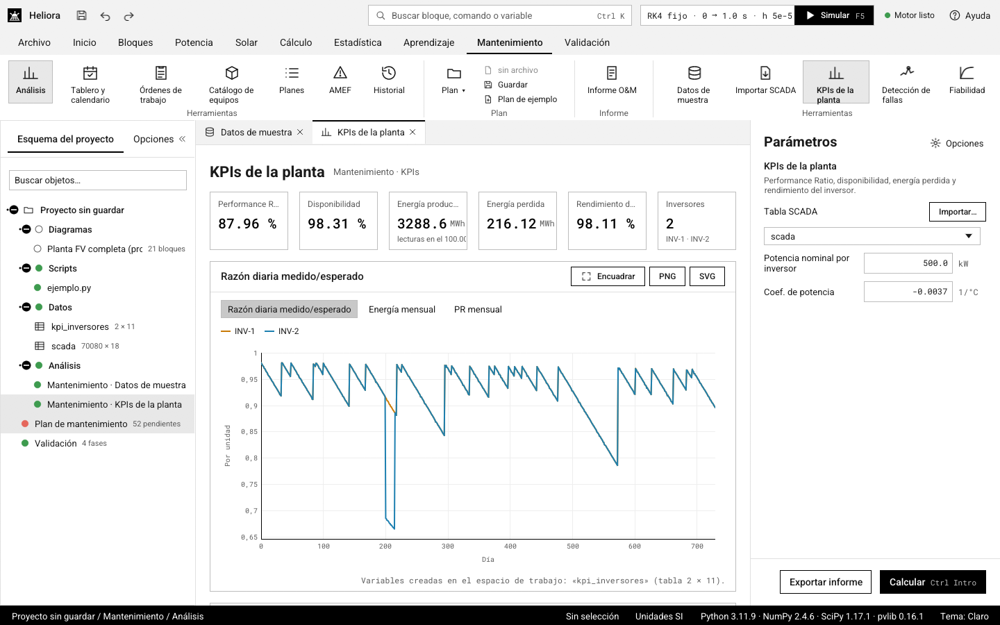
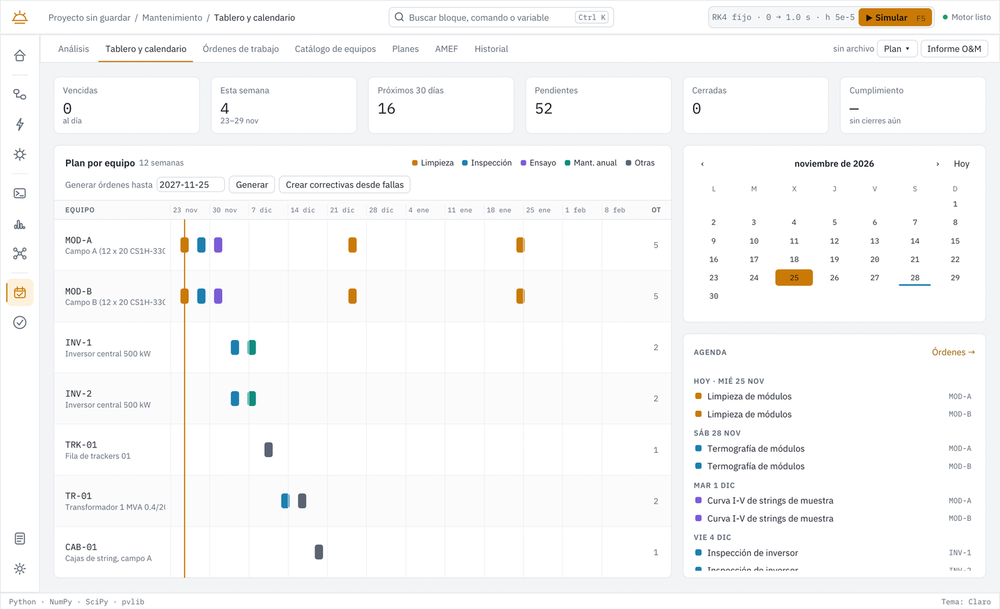
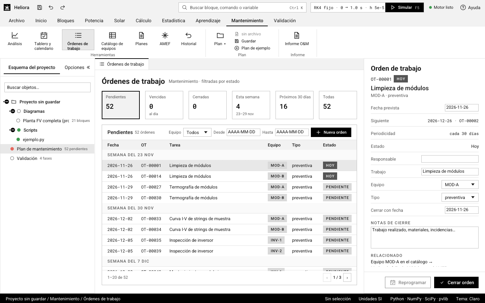
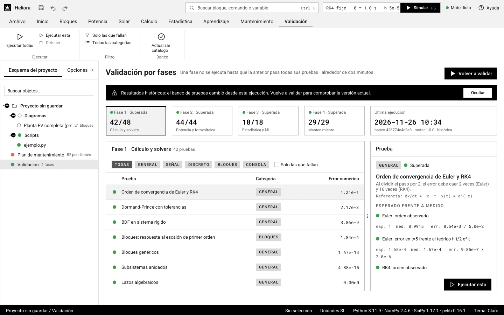
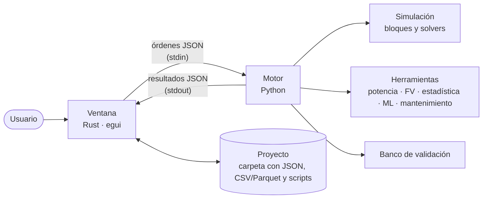

<div align="center">


# Heliora

**Cálculo técnico y simulación por bloques para plantas solares fotovoltaicas.**

Modela la planta con sus inversores, analiza sus datos de operación y planifica su mantenimiento
en una sola aplicación de escritorio, sin conexión a internet.

[](https://github.com/YAGOHEHE/heliora/actions/workflows/ci.yml)
[](https://github.com/YAGOHEHE/heliora/actions/workflows/instaladores.yml)


[](LICENSE)

[Instalar](#instalar) · [Funcionalidades](#funcionalidades) · [Arquitectura](#arquitectura) ·
[Desarrollo](#desarrollo) · [Documentación](#documentación)


</div>

## Qué es

Heliora reúne en una ventana el trabajo de ingeniería de una planta fotovoltaica:

| Área | Qué permite |
|---|---|
| **Simulación** | Diagramas de bloques con 127 bloques (eléctrica, potencia, fotovoltaica, térmica, máquinas, almacenamiento, control), cuatro solvers y linealización. |
| **Cálculo** | Consola y scripts de Python con espacio de trabajo, importación de datos y gráficas 2D y 3D. |
| **Análisis** | Electrónica de potencia, módulos FV, estadística y aprendizaje automático mediante formularios con informes exportables. |
| **Operación** | Datos SCADA, KPIs de planta, detección de fallas, fiabilidad y planificación del mantenimiento. |
| **Validación** | Banco de pruebas por fases contra soluciones analíticas y hojas de datos, con el error de cada medida. |

## Instalar

Los instaladores incluyen Python y todas sus librerías: no hace falta instalar nada más.

| Sistema | Archivo | Notas |
|---|---|---|
| Windows 10/11 (64 bits) | `Heliora-Setup-<versión>.exe` | Instala en la carpeta del usuario, sin permisos de administrador, con accesos en el menú Inicio y, si se elige, en el Escritorio. |
| macOS 11 o posterior (Apple Silicon) | `Heliora-<versión>-macos-arm64.dmg` | Se arrastra Heliora a Aplicaciones. |

Se descargan desde [Releases](https://github.com/YAGOHEHE/heliora/releases) (versiones con etiqueta
`v*`) o desde los artefactos del último flujo
[Instaladores](https://github.com/YAGOHEHE/heliora/actions/workflows/instaladores.yml) de `main`.

> [!NOTE]
> Los instaladores no llevan firma digital, así que el sistema avisa la primera vez.
> **Windows:** en «Windows protegió su PC», pulsa «Más información» y «Ejecutar de todas formas».
> **macOS:** clic derecho sobre Heliora → «Abrir», o Ajustes del Sistema → Privacidad y seguridad →
> «Abrir igualmente».

## Funcionalidades

### Inicio

Acceso a los módulos, el proyecto abierto, los KPIs de la planta, las próximas órdenes de trabajo y el
estado de la validación. Si el motor o el banco de pruebas cambiaron desde la última validación, se
marca como histórica y ofrece volver a validar. La barra superior lleva el buscador de comandos
(`Ctrl K`) y «Simular» (`F5`) desde cualquier módulo.



### Simulación por bloques

Lienzo con librería de bloques, subsistemas, cuatro solvers (Euler, RK4, Dormand-Prince y BDF),
detección de lazos algebraicos y linealización en el punto de operación con Bode, escalón y polos.
Incluye minimapa, cables en ángulo recto, bloques recientes, ayuda de cada parámetro y el resultado de
la última simulación con su huella sha256. «Linealizar aquí» deja además el modelo en la variable
`lin`, que usan las herramientas de Control con «Planta: modelo linealizado».


### Entorno de cálculo

Consola y scripts de Python, espacio de trabajo con vista y exportación de variables, importación de
CSV (también los de Excel en español: separador «;», coma decimal y Windows-1252), TSV y Parquet, y
gráficas exportables a PNG y SVG.



### Electrónica de potencia

Pérdidas y eficiencia del inversor, filtro LCL (resonancia, respuesta en frecuencia y valores de diseño)
y control: Bode y márgenes, escalón, lugar de las raíces y ajuste de un PI.


### Fotovoltaica

Modelo de un diodo desde la hoja de datos, curvas I-V y P-V por irradiancia y temperatura, sombreado
parcial con diodos de bypass y recurso solar con pvlib. Busca además en la base CEC de pvlib (unos
21 500 módulos comerciales).



### Estadística y aprendizaje automático

Descriptiva, distribuciones, Weibull, pruebas de hipótesis, regresión, ANOVA, series temporales y
control estadístico de procesos. Regresión y clasificación con validación aleatoria, temporal o con
conjunto de prueba, aviso de sobreajuste, clustering, PCA, anomalías y «Aplicar modelo» con un modelo
entrenado o guardado.

<table>
<tr>
<td></td>
<td></td>
</tr>
</table>

### Mantenimiento

Importación de SCADA real (CSV regionales, fechas día/mes, columnas con unidades, duplicados) y KPIs de
planta: cada inversor se integra con su propio intervalo de registro y el informe indica la cobertura
de los datos y qué KPIs no se pueden calcular. Detección de fallas, fiabilidad, y un planificador con
tablero, calendario, órdenes de trabajo, catálogo de equipos, planes, AMEF e informe O&M.



<table>
<tr>
<td></td>
<td></td>
</tr>
</table>

### Validación

Pruebas por fases contra soluciones analíticas y hojas de datos, con el error numérico de cada medida
frente a su tolerancia. Una fase no se ejecuta hasta que la anterior pasa todas sus pruebas.



## Arquitectura

La ventana y el motor son dos procesos que se comunican por entrada y salida estándar con mensajes
JSON, uno por línea. La ventana no calcula: dibuja y envía órdenes; el motor simula, analiza y valida.



| Componente | Tecnología |
|---|---|
| Ventana | Rust, [egui/eframe](https://github.com/emilk/egui) 0.33 |
| Motor de cálculo | Python 3.12 con NumPy, SciPy, pandas, scikit-learn, statsmodels y pvlib |
| Formato de proyecto | Carpeta con JSON canónico, CSV o Parquet y scripts `.py`, pensada para Git |
| Instaladores | python-build-standalone, Inno Setup (Windows), `.app`/`.dmg` (macOS) |
| Integración continua | GitHub Actions: comprobación en Windows, macOS y Linux; instaladores |

## Desarrollo

Requisitos: Rust estable y Python 3.11 o 3.12 (en Windows, Rust con la cadena MSVC).

    git clone https://github.com/YAGOHEHE/heliora.git
    cd heliora
    python -m venv .venv
    .venv/bin/pip install -r engine/requirements.txt     # Windows: .venv\Scripts\pip
    cargo run

Pruebas:

    cargo clippy -- -D warnings && cargo test
    cd engine && ../.venv/bin/python validar_todo.py      # Windows: ..\.venv\Scripts\python

```
heliora/
├── src/                 ventana (Rust/egui)
├── engine/
│   ├── heliora/         motor: servidor, simulación (sim/), librerías (lib/), herramientas, validación
│   ├── ejemplos/        diagramas de ejemplo en JSON
│   └── validar_todo.py  banco de pruebas completo
├── packaging/           instaladores de Windows y macOS
├── docs/                documentación técnica y capturas
└── MECHANICS.md         origen de cada valor del modelo
```

## Documentación

| Documento | Contenido |
|---|---|
| [docs/desarrollo.md](docs/desarrollo.md) | Entorno local, mapa de archivos, pruebas, procedencia de resultados, proyectos y Git, CI |
| [MECHANICS.md](MECHANICS.md) | De dónde sale cada valor del modelo y cuáles son estimados |
| [docs/diseno_motor_dae.md](docs/diseno_motor_dae.md) | Diseño propuesto del motor DAE (sin construir) |

## Licencia

Distribuido bajo la [licencia MIT](LICENSE).
