<div align="center">


# Heliora

**面向光伏电站的工程计算与框图仿真。**

在一个离线运行的桌面应用中，完成电站及其逆变器的建模、运行数据分析和维护计划。

[](https://github.com/YAGOHEHE/heliora/actions/workflows/ci.yml)
[](https://github.com/YAGOHEHE/heliora/actions/workflows/instaladores.yml)


[](LICENSE)

[Español](README.md) · [English](README.en.md) · **简体中文**

[安装](#安装) · [功能](#功能) · [架构](#架构) · [开发](#开发) · [文档](#文档)

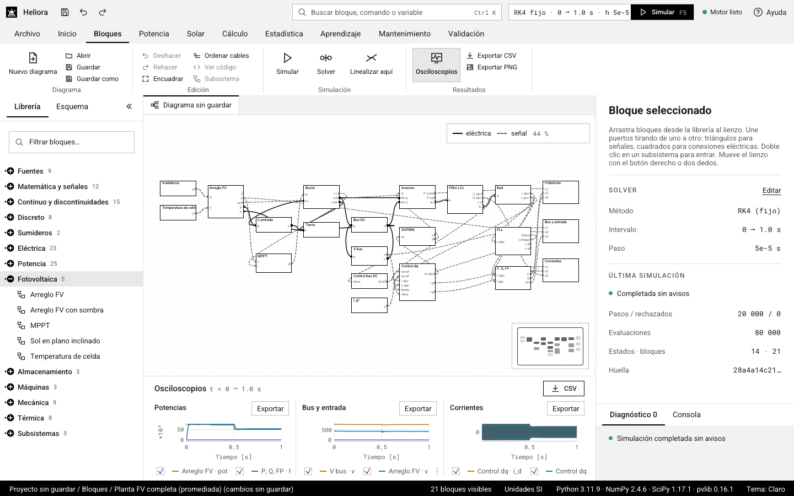

</div>

> [!NOTE]
> 应用界面和技术文档均为西班牙语。

## 简介

Heliora 将光伏电站的工程工作集中在一个窗口中：

| 领域 | 功能 |
|---|---|
| **仿真** | 包含 127 个模块（电气、电力电子、光伏、热学、电机、储能、控制）的框图，五种求解器及线性化。 |
| **计算** | 带工作区的 Python 控制台和脚本、数据导入以及二维和三维图表。 |
| **分析** | 通过表单完成电力电子、光伏组件、统计和机器学习分析，报告可导出。 |
| **运维** | SCADA 数据、电站 KPI、故障检测、可靠性和维护计划。 |
| **验证** | 分阶段测试，对照解析解和产品数据手册，给出每项测量的误差。 |

## 安装

安装包已内置 Python 及其全部库，无需另外安装任何软件。

| 系统 | 文件 | 说明 |
|---|---|---|
| Windows 10/11（64 位） | `Heliora-Setup-<版本>.exe` | 安装到用户目录，无需管理员权限；创建开始菜单快捷方式，可选创建桌面快捷方式。 |
| macOS 11 或更高版本（Apple Silicon） | `Heliora-<版本>-macos-arm64.dmg` | 将 Heliora 拖入“应用程序”文件夹。 |

可从 [Releases](https://github.com/YAGOHEHE/heliora/releases)（带 `v*` 标签的版本）下载，或从
`main` 分支最近一次 [Instaladores](https://github.com/YAGOHEHE/heliora/actions/workflows/instaladores.yml)
运行的构建产物中下载。

> [!NOTE]
> 安装包没有数字签名，因此系统会在首次运行时发出警告。
> **Windows：** 在“Windows 已保护你的电脑”提示中，点击“更多信息”，然后点击“仍要运行”。
> **macOS：** 右键点击 Heliora →“打开”，或前往“系统设置”→“隐私与安全性”→“仍要打开”。

## 功能

### 首页

进入各模块，查看当前项目、电站 KPI、即将到期的工单和验证状态。如果自上次验证以来计算引擎或测试集发生了变化，
该结果会被标记为“历史结果”，并提示重新验证。顶部栏提供命令面板（`Ctrl K`），并可在任何模块中点击
“Simular”（仿真，`F5`）。

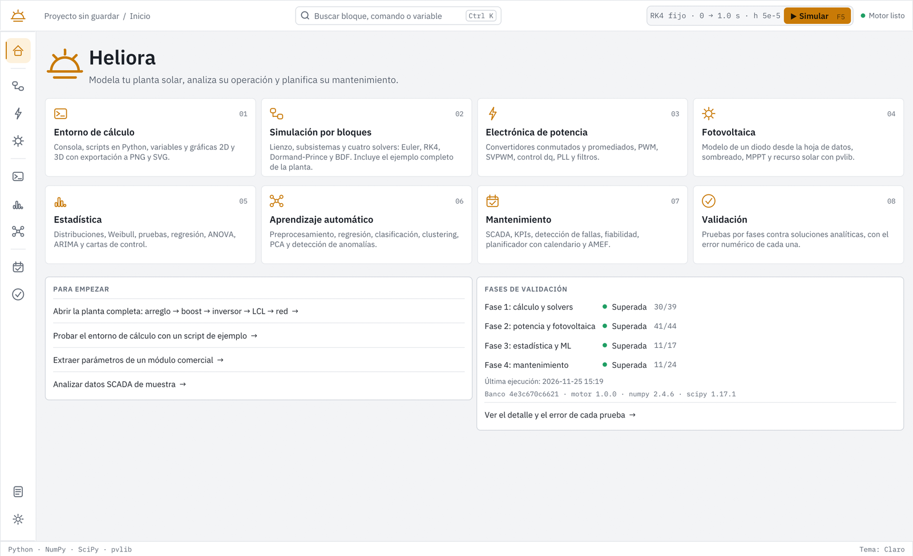

### 框图仿真

画布配有模块库、子系统、五种求解器（Euler、RK4、Dormand-Prince、BDF 和 DAE；DAE 为隐式求解器，将电路网络与框图
联立求解，支持并联电容以及通过齿轮刚性连接的惯量）、代数环检测，以及在工作点处的线性化
（伯德图、阶跃响应和极点）。还提供小地图、直角连线、最近使用的模块、每个参数的说明，以及带 sha256 指纹的
最近一次仿真结果。“Linealizar aquí”（在此线性化）还会把模型保存在变量 `lin` 中，供控制工具的
“Planta: modelo linealizado”（被控对象：线性化模型）使用。

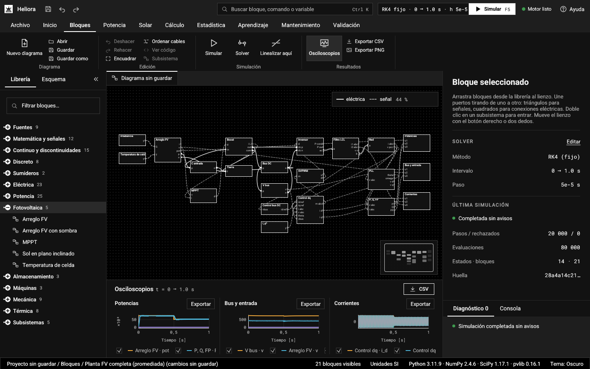

### 计算环境

Python 控制台和脚本，可查看和导出变量的工作区，支持导入 CSV（包括使用西班牙语区域设置的 Excel 导出的
CSV 文件：`;` 分隔符、小数逗号和 Windows-1252 编码）、TSV 和 Parquet，图表可导出为 PNG 和 SVG。

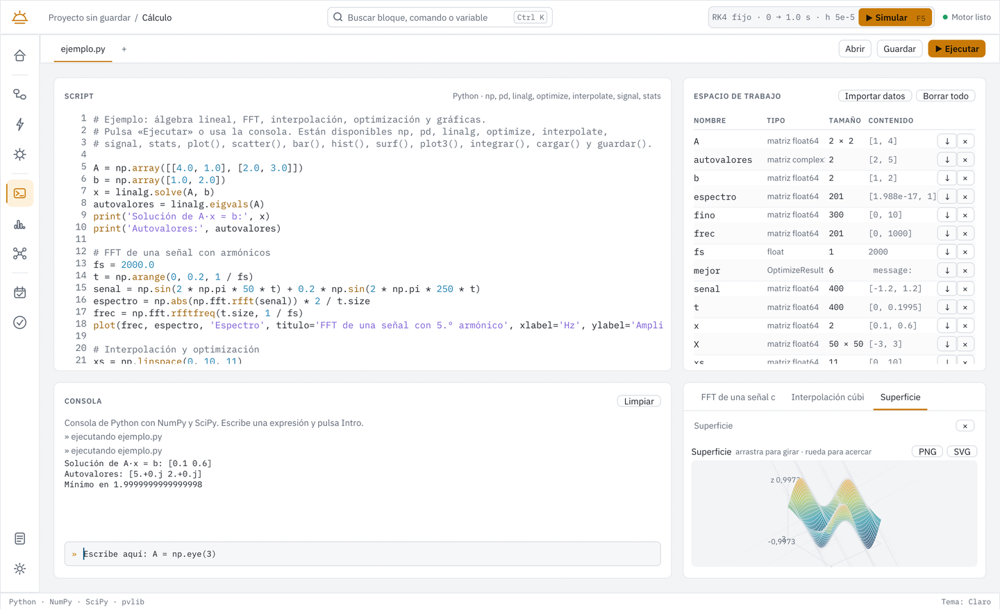

### 电力电子

逆变器损耗与效率、LCL 滤波器（谐振、频率响应和设计参数）以及控制：伯德图与稳定裕度、阶跃响应、根轨迹和 PI 整定。

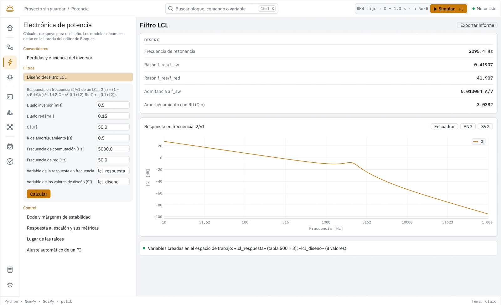

### 光伏

根据数据手册建立单二极管模型，按辐照度和温度绘制 I-V 和 P-V 曲线，考虑旁路二极管的局部遮挡分析，以及基于 pvlib
的太阳能资源分析。还可检索 pvlib 的 CEC 数据库（约 21,500 种商用组件）。

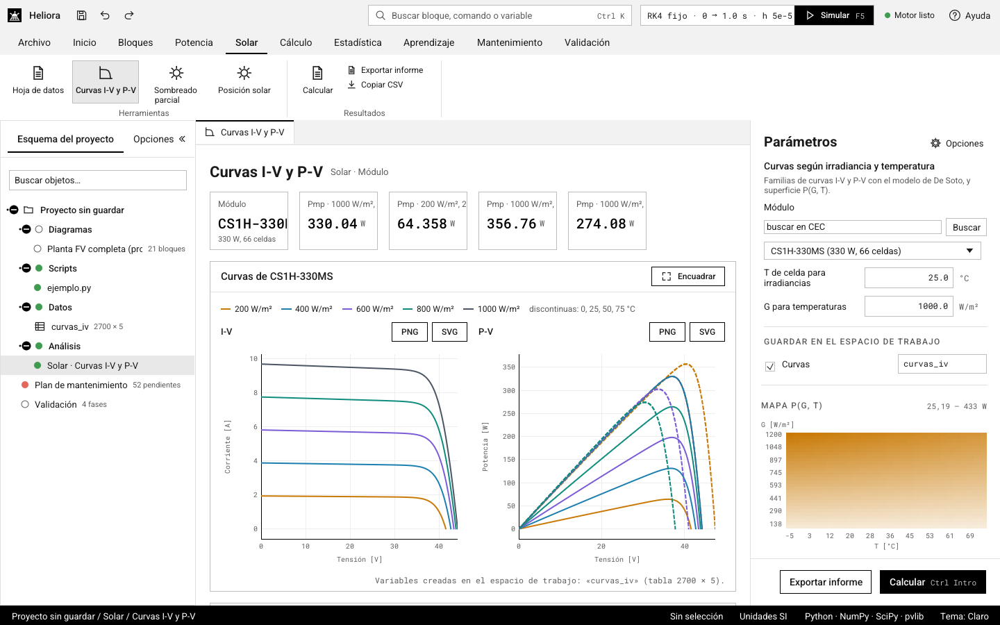

### 统计与机器学习

描述统计、分布拟合、Weibull 分析、假设检验、回归、方差分析、时间序列和统计过程控制。回归和分类支持随机验证、
按时间验证或使用独立测试集进行验证，提供过拟合警告，并支持聚类、主成分分析和异常检测；还可通过
“Aplicar modelo”（应用模型）使用已训练或已保存的模型进行预测。

<table>
<tr>
<td>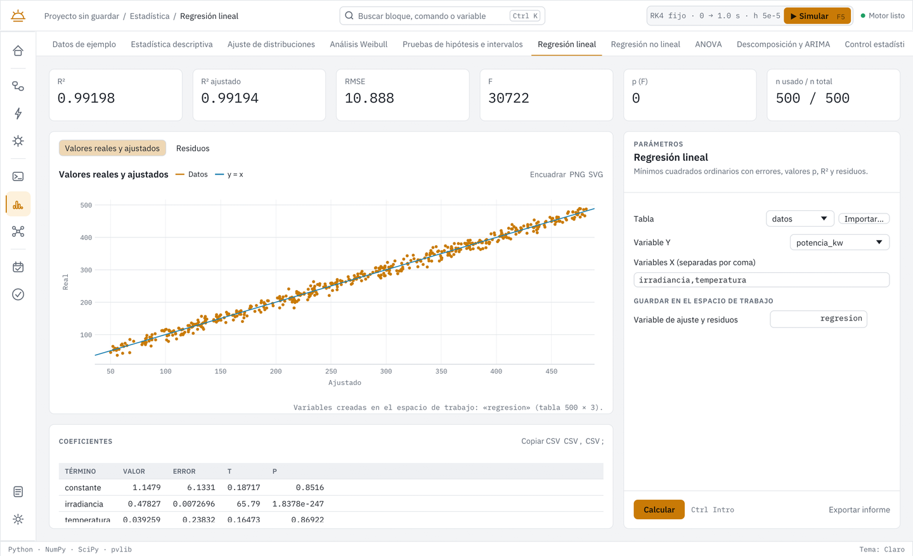</td>
<td>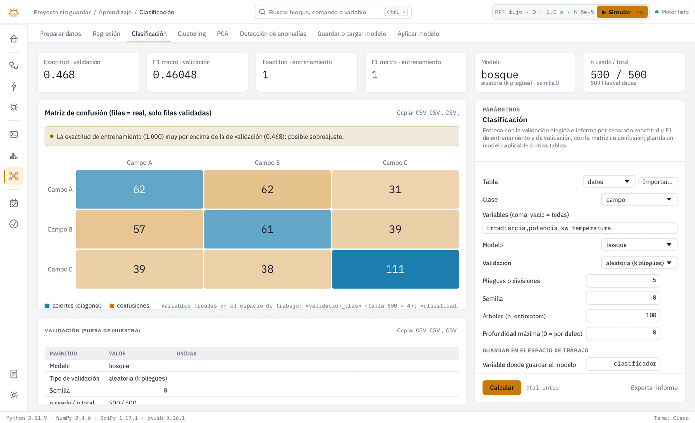</td>
</tr>
</table>

### 维护

导入真实 SCADA 数据（各地区 CSV 格式、日/月日期格式、带单位的列名、重复记录），计算电站 KPI：对每台逆变器的数据，
按其各自的记录间隔进行积分，报告给出数据覆盖率以及无法计算的 KPI。另有故障检测、可靠性分析，以及包含看板、
日历、工单、设备目录、计划、FMEA 和运维报告的维护计划工具。

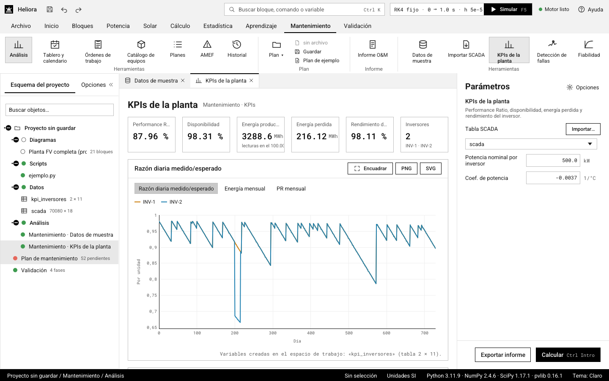

<table>
<tr>
<td>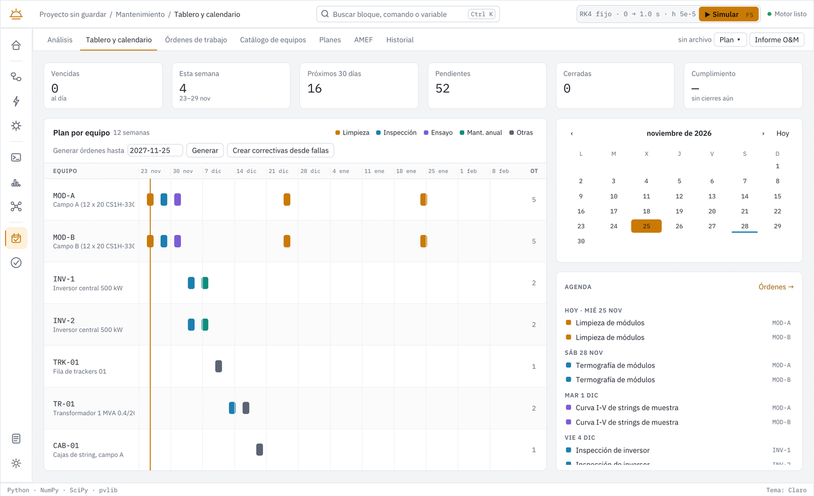</td>
<td>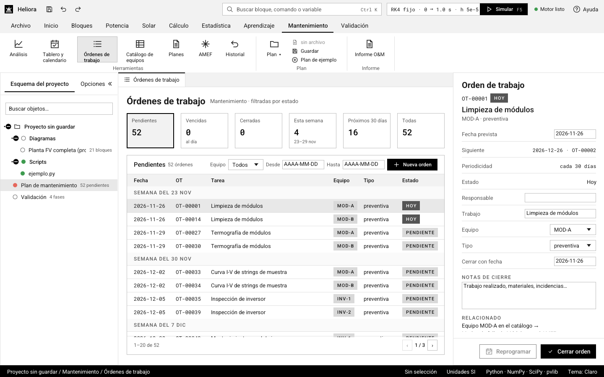</td>
</tr>
</table>

### 验证

分阶段测试，对照解析解和产品数据手册，给出每项测量的数值误差，并与相应容差进行比较。前一阶段的所有测试通过后，才会运行下一阶段。

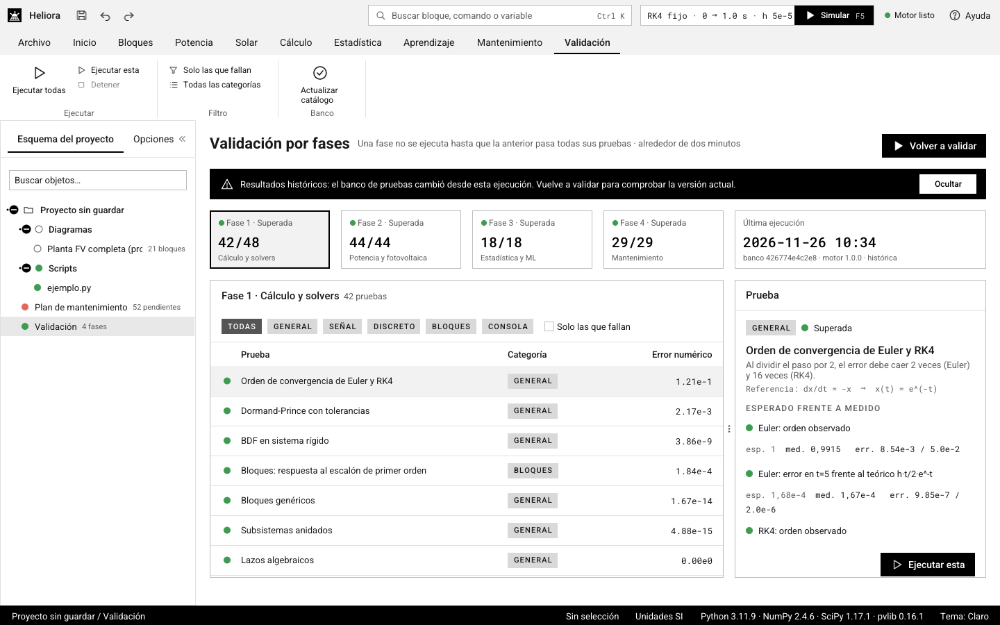

## 架构

窗口和计算引擎是两个进程，通过标准输入输出以 JSON 消息通信，每行一条。窗口不做计算，只负责绘制界面和发送命令；
引擎负责仿真、分析和验证。

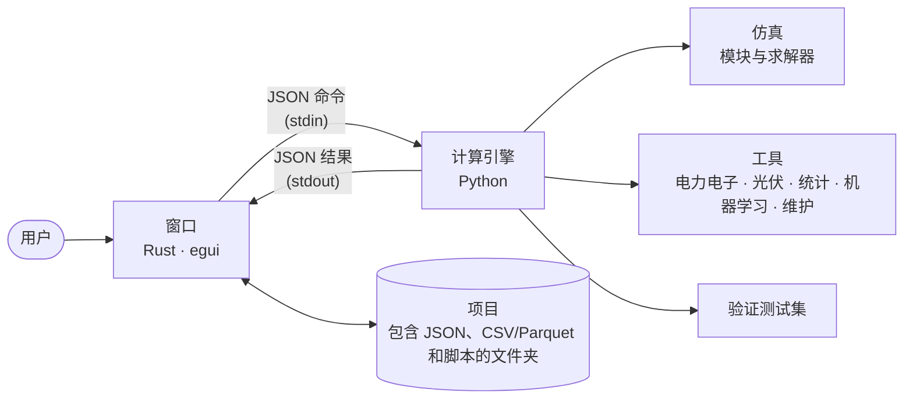

| 组件 | 技术 |
|---|---|
| 窗口 | Rust，[egui/eframe](https://github.com/emilk/egui) 0.33 |
| 计算引擎 | Python 3.12，使用 NumPy、SciPy、pandas、scikit-learn、statsmodels 和 pvlib |
| 项目格式 | 包含规范化 JSON、CSV 或 Parquet 以及 `.py` 脚本的文件夹，便于用 Git 管理 |
| 安装包 | python-build-standalone、Inno Setup（Windows）、`.app`/`.dmg`（macOS） |
| 持续集成 | GitHub Actions：在 Windows、macOS 和 Linux 上检查；生成安装包 |

## 开发

环境要求：稳定版 Rust，以及 Python 3.11 或 3.12（Windows 上需使用 MSVC 工具链的 Rust）。

    git clone https://github.com/YAGOHEHE/heliora.git
    cd heliora
    python -m venv .venv
    .venv/bin/pip install -r engine/requirements.txt     # Windows: .venv\Scripts\pip
    cargo run

测试：

    cargo clippy -- -D warnings && cargo test
    cd engine && ../.venv/bin/python validar_todo.py      # Windows: ..\.venv\Scripts\python

```
heliora/
├── src/                 窗口（Rust/egui）
├── engine/
│   ├── heliora/         计算引擎：服务端、仿真（sim/）、库（lib/）、工具、验证
│   ├── ejemplos/        JSON 格式的示例框图
│   └── validar_todo.py  完整测试集
├── packaging/           Windows 和 macOS 安装包
├── docs/                技术文档和截图
└── MECHANICS.md         模型中每个数值的来源
```

## 文档

以下文档均为西班牙语。

| 文档 | 内容 |
|---|---|
| [docs/desarrollo.md](docs/desarrollo.md) | 本地环境、文件索引、测试、结果溯源、项目与 Git、持续集成 |
| [MECHANICS.md](MECHANICS.md) | 模型中每个数值的来源，以及哪些是估计值 |
| [docs/diseno_motor_dae.md](docs/diseno_motor_dae.md) | DAE 引擎的设计方案（尚未实现） |

## 许可证

本项目采用 [MIT 许可证](LICENSE) 发布。
